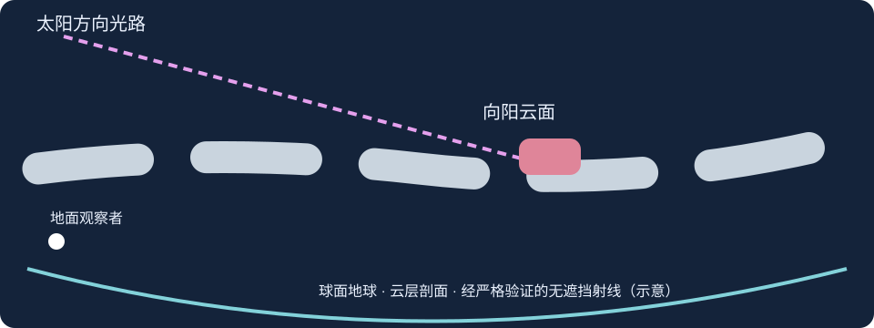
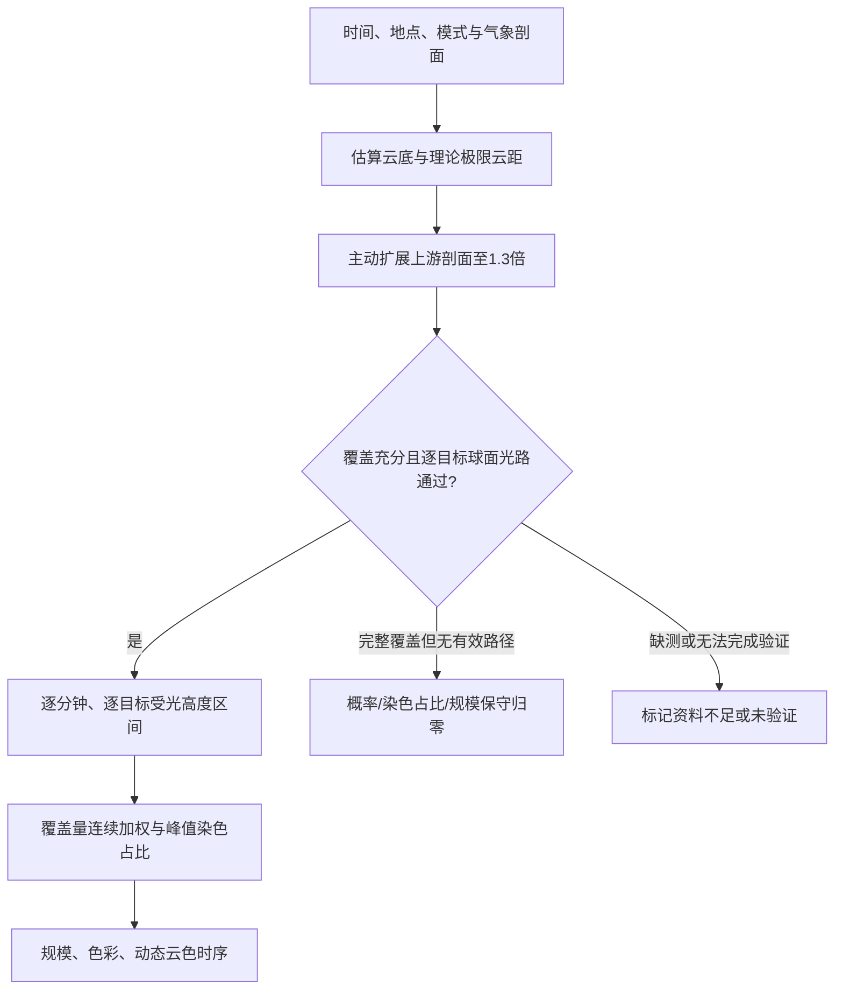
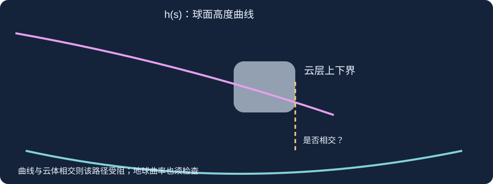
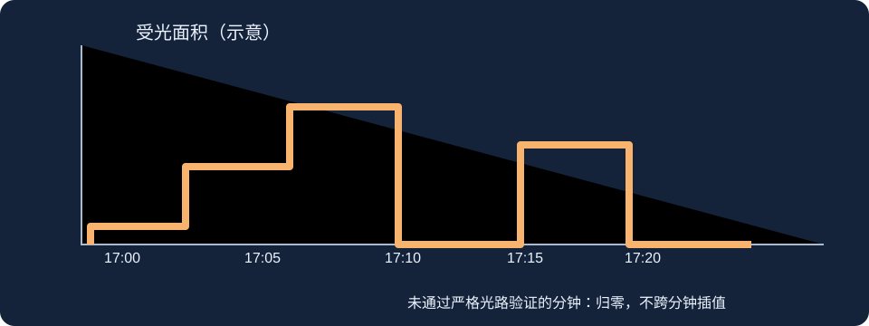

# Burning Sky — 算法与原理 Release Notes

> 基于 Weather Photography V1.0.8 内集成的 Burning Sky 当前代码；本次更新增加严格光路的「等效无遮挡通道」解释。本文是**算法说明而非使用教程**。版本中的概率/颜色/规模含经验指数，并非经大量实拍校准的真实统计概率或完整三维辐射传输模型。

## 1. 核心哲学：把“能照到”“有云可照”“看起来多壮观”分开

1. **几何门槛**：在真实太阳方位和高度角下，球面太阳光线能否穿过已采样的大气剖面，到达某个目标中高云的向阳面？
2. **可染色云占比**：同一分钟、同一个目标的光路经过严格验证后，目标云有多少垂直受光份额，并按覆盖量与沿采样轴的距离宽度加权？
3. **潜在染色规模**：霞云距离内拥有多少中高云 × 其中多少被判定可受光？
4. **色彩与发生指数**：在几何成立前提下，能见度、AOD、风、低云、中高云及太阳角度如何影响光学质量与经验评分？

**不要把“高云100%”直接理解为“100%火烧云”**；也不要把“存在一条有效光路”理解为“所有高云都能染色”。

## 2. 数据层：多模式天气、逐点气压层与气溶胶

- **气象预报**：Open-Meteo 多模式气象数据（包括 ECMWF、GFS 等，实际可用模式依部署配置），按当地事件时刻提取云量、气压层云/湿度、能见度、风等。
- **方向剖面**：以日出/日落方位建立样本轴；从中心到远处采样，不把未经采样的区域擅自当作晴天。不同距离点的气象网格平均数据不等于一张连续真实云照片。
- **层次**：低/中/高云汇总值用于经验筛选；严格光路需要气压层云高度。缺失高度时可通过湿度/先验进行有限重构并标注推断数据来源。
- **AOD（550 nm）**：优先使用配置的 CAMS 数据及所选来源，支持手动值或垂直消光实验。AOD是整层气溶胶光学厚度，不能直接等同于能见度、AQI或气压层云量。
- **手动修正**：通过修改距离区间的低、中、高云量及对应剖面，复算光路与受光结果；修正超出已采样区间不能凭空生成实测数据。

## 3. 云底与地球曲率：为什么天黑后高云还可能受光

设地球半径 **R ≈ 6371 km**，有效云底高度 **H**（km），项目使用近似的“扩展极限云距”表达式：

\[
D_{\mathrm{lim}}\approx\sqrt{8RH}=2\sqrt{2RH}
\]

这相当于将单侧地平线距离近似加倍，作为云底/AOD等效几何所限定的上游范围。**它是程序的近似控制量，不是对每朵云可见性与受光性的完整解析证明。**

有效云底按示意模型修正：

\[
H_{\mathrm{eff}}=\max(0,H_{\mathrm{base}}-H_{\mathrm{AOD}}),\quad
H_{\mathrm{AOD}}=L\ln\left(\frac{\mathrm{AOD}}{L\beta_{\mathrm{crit}}}\right)
\]

其中 **L** 是选定气溶胶垂直尺度高，**βcrit** 是经验消光阈值。这是保守的等效高度建模，并不意味着AOD真的在那个高度形成一堵不透明的墙。

## 4. 两种“云洞”不能混为一谈

### 4.1 云量快筛的晴空间隔

离散距离样本中，低/中/高云量**均不超过15%**的点形成候选晴空点；相邻点组成区间，宽度达到约 **15 km** 才保留。区间端点按相邻样本中点估计，而非精确真实云缘。

### 4.2 严格验证的等效无遮挡通道（本次更新）

对于在时间 **t**、目标云面距离 **dface**、目标高度 **h** 下通过完整球面追踪的光线，记录：

\[
[d_{\mathrm{face}},\;D_{\mathrm{check}}],\qquad
W_{\mathrm{equiv}}=D_{\mathrm{check}}-d_{\mathrm{face}}
\]

**显示示例（虚构数字）**：「严格光路等效无遮挡通道：约120–740 km，等效宽度约620 km」。这一宽度指**沿采样轴的无阻挡光线路径投影长度**，并非地面上有一个620 km宽的晴天洞！在全高云覆盖情形，高于云顶的光线也可能在指定高度无遮挡。

此处优先报告**最宽的一条已验证通道**，并可列出不同目标距离的其他代表通道；不把多个时间片段相加，也不将未经验证的候选光线冒充真实云洞。

> 注意：这类通道统计描述的是从目标云向太阳方向、直到1.3倍验证边界的**可证实部分**；没有声称太阳至地球大气之外的全路程都被逐点采样。

## 5. 严格球面光路：太阳不是沿地面平行照射

严格验证器把每一朵目标云的位置固定在事件采样轴上，而每一分钟重新计算**目标所在地的太阳高度角与太阳方位角**。根据光线穿过的球面距离、云单元上下界和地球遮挡逐段计算相交。

核心高度函数的一种等价表达是：

\[
h(s)=\frac{(R+h_0)\cos\alpha}{\cos(s/R+\alpha)}-R
\]

其中 **h0** 为目标云面高度，**α** 为目标位置的太阳高度角，**s** 为沿球面的上游距离。检查该曲线与每个阻挡云单元高度区间是否相交，并检查曲线是否低于地表。

当前主验证还进行：

- 目标取**向阳面**，不是把云中心当作受光目标。
- 逐分钟遍历目标云的多个可用**高度带**，一个目标可有多个不相交的有效受光带。
- 对实际太阳方位偏离原始采样轴的情况做横向覆盖检查，偏离超过原采样半径 **15 km** 的分钟/目标不直接视为已验证。
- 上游剖面至少覆盖 **1.3 × 极限云距** 才称为完整；有采样点缺失气压层或剖面跨度过大时报告无法验证。
- 目前**阻挡云**仍采用约 **25% 云量阈值**的保守二值假设；这不是物理精确透射率。把它改为连续云透光必须有不同于“光路已证实”的不确定性标注。

## 6. 连续目标云与“逐分钟 × 逐目标”门控

此前目标云量低于25%会被忽略；最新代码将**目标云**按非零云量连续加权，但**阻挡云**仍保留25%的二值筛选。

假设第 i 个目标云的沿轴距离宽度为 Δdi、云量为 Ci（0～1）、经严格验证的受光高度占比为 Fi(t)，则当前一维代理量为：

\[
R_{\mathrm{tint}}(t)=
\frac{\sum_i\Delta d_i C_iF_i(t)}{\sum_i\Delta d_i C_i},\qquad
R_{\mathrm{tint,peak}}=\max_t R_{\mathrm{tint}}(t)
\]

**Fi(t) 必须来自当前分钟、当前目标云面、当前有效高度带的严格光路证据。** 一条光路不能为别的云、别的分钟“开绿灯”；被拒绝的分钟在云色时序中不得插值填色。

上式本质为**沿太阳方向的一维剖面受光覆盖代理**，并非把全部方位/全部仰角积分后的真实二维可见天空面积。它目前也尚未完整求解受光云面到地面观察者视线的遮挡、云顶/云底辐射传输与云层光学厚度。

## 7. 潜在霞云距、目标量与火烧云规模

潜在霞云距指本地向太阳方向连续中高云所形成的目标区边缘；程序结合云层分段、被确认的晴空间隔和离散采样单元边界作估计，**与1.3倍上游验证距离完全不同**。

当前规模的主公式为：

\[
S_{\mathrm{raw}}=C_{\mathrm{mid+high,range}}\times R_{\mathrm{tint,peak}}
\]

其中比例按0～1计算，展示时可转为0～100的数值；**不再乘发生概率**。例如中高云80%，可染色比例80%，规模为64（约64%的代理有效覆盖）。

**目前代码采用的类别阈值**：0为不烧；0～10（不含10）为微烧；10～30为小烧；30～60为中烧；60及以上为大烧。先前讨论过“35以上即大烧”的可能性，**尚未在本版本实行**；这属于未来视觉规模分级的主观校准问题，不改变原始面积代理量。

## 8. 发生概率：经验指数加严格光路门槛

基础经验分以50为起点，按太阳方向云量、低云、全云、能见度、风速及AOD等修正，再经云洞/光路与特殊判定调整。例如中高云量过少被减分、低云覆盖高被减分、AOD低可加分；详见 `burning_sky/algorithm.py` 的 `infer_from_cloud_path()` 和路径评分函数。

**关键区别**：输出写作“常规概率”，但数值并未经过大量真实日落观测校准，不应理解为“66%＝100次同样条件有66次一定出现”。经过充分的1.3倍验证却没有任何目标有效光路时，系统执行保守归零；资料不足与明确无光路应分开标注。

特殊判定包括剖面云底过低、近场低云遮挡极高、明显少云等。部分阈值仍依赖观测场定义与既有经验代码；尤其“云量不足”相关分支需注意局部100 km总云量与中高云量定义的历史差异。

## 9. 色彩：太阳角度、AOD与峰值代表色

颜色不是气象模式直接给出的云彩RGB。模型依受光有效时间和面积、太阳高度角等生成**示意色相**，再按AOD调整暖色饱和度、亮度。较高AOD会显著灰化色块；低AOD可保留色彩。云色时序的纵向重点为**有效染色面积代理**，不是仅看亮度；面积接近时再兼顾饱和度和亮度选代表色块。

AOD的可视化色彩修正是经验映射，**不是光谱辐射传输反演**。峰值颜色也不等于拍摄照片的实际白平衡或相机传感器RGB。

## 10. 剖面图、八方位图及边界

- **云层剖面**：原始气压层与推断云高度应分开标注；候选紫色光路与**严格通过验证的光路**必须用不同线型，不能为了好看补画不存在的曲线。
- **二维八方位图**：属于多方向空间展示和辅助证据，不能把太阳方向的一条严格光路无限扩张到八方位。八方位目前不等于完整三维云体/全景受光积分。
- **人工修正**：重跑同一气象与高度模型链路；不能用未采样距离的输入推断完整气象实况。

## 11. 已知的局限与尚待研究

1. **阻挡云25%硬门槛**：仍可能使24%→25%出现突变，改造需引入云光学厚度/透射不确定性，但绝不能凭经验透射值伪造“严格已验证通道”。
2. **一维受光不等于二维面积**：未完成全方位的真实面积积分、受光面至观察者的完整可见性追踪。
3. **1.3倍验证是有限数据域**：判断严格限定在已采样路径；大气外的真正太阳来光与云层三维侧向遮挡没有被完整扫描。
4. **气压层重构有限**：云厚、云顶、水平云边界均可能随预报空间分辨率、缺测与重构假设变化。
5. **经验评分未经过实拍校准**：概率、色彩、规模类别建议与后续实际晚霞图片/目视记录建立样本统计校准。
6. **云洞距离与等效通道宽度不同**：新字段显示的是一条严格通过验证光线的**有效投影段**，不能据其判断真实天空云洞形状、面积或宽度。

---

### 本次变更摘要

- 已验证目标光路的摘要不再只写“1.3倍极限云距内存在至少一条通道”，而是显示**代表性目标向阳面起点—验证边界、等效宽度**；有多个目标时列出部分代表通道。
- 原始云量晴空间隔与光路等效无遮挡通道分开显示；两者的物理意义不可互换。
- 延续上一版目标云连续加权、逐分钟逐目标严格受光高度带、1.3倍覆盖验证及既有评分/规模规则。本次**不改变**概率算法、云量阈值或规模分级。
